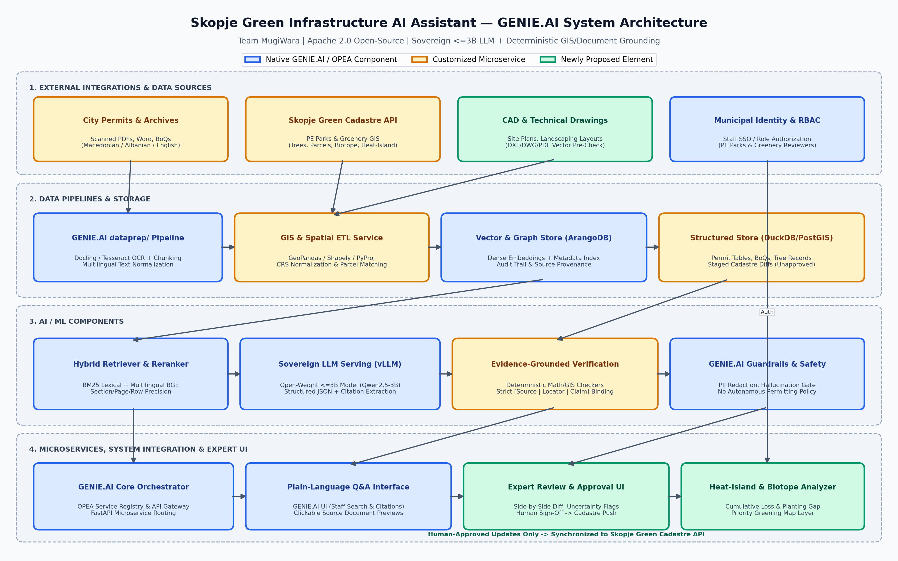

# Skopje Green Infrastructure AI Assistant — Team MugiWara

[](LICENSE)
[](https://genie-ai-7e342b.opensource.unicc.org/docs/)
[](https://ieeeht.org/)

An open-source, evidence-grounded **GenAI Green Infrastructure Assistant** for **Skopje, North Macedonia**, built by **Team MugiWara** (*Adama Traore* & *Mariama Barry*, Université Numérique Cheikh Hamidou Kane — UNCHK, Senegal) for the **IEEE Humanitarian Technologies × UNDP GenAI for Good Challenge: Cities Edition (2026)**.

---

## Overview

Skopje's rapid urban growth puts pressure on urban trees and green spaces, intensifying urban heat-island effects in dense neighborhoods. While **PE Parks and Greenery** maintains strong digital foundations—the **Green Cadastre**, urban **heat-island map**, and **biotope map**—vital updates on tree removals, replacement planting, and landscaping obligations remain scattered across unstructured Macedonian/Albanian construction permits, Bills of Quantities (BoQs), scanned PDFs, and CAD drawings.

Our assistant bridges this gap using the **GENIE.AI / OPEA** modular microservices framework, sovereign open-weight models ($\le 3\text{B}$ parameters), and deterministic geospatial/tabular verification—enforcing a strict **Human-in-the-Loop Expert Review Workflow** before any official Cadastre update.

---

## System Architecture (GENIE.AI / OPEA)



1. **External Integrations & Data Sources**:
   - **City Permits & Archives**: Scanned PDFs, Word files, and BoQs (Macedonian, Albanian, English).
   - **Skopje Green Cadastre API**: PE Parks & Greenery GIS layers (trees, parcels, biotope, heat-island).
   - **CAD & Technical Drawings**: Pre-check pipeline for site plans and landscaping layouts.
   - **Municipal Identity & RBAC**: Role-based staff access control.
2. **Data Pipelines & Storage**:
   - **GENIE.AI `dataprep/`**: Multilingual OCR (`Tesseract` / `Docling`) and provenance-preserving chunking.
   - **GIS & Spatial ETL**: `GeoPandas`, `Shapely`, and `PyProj` CRS normalization and parcel matching with uncertainty flags.
   - **ArangoDB & DuckDB/PostGIS**: Vector embeddings, document-provenance graphs, structured BoQs, and staged (unapproved) Cadastre diffs.
3. **AI / ML Components**:
   - **Hybrid Retriever & Reranker**: BM25 lexical + multilingual dense embeddings (`BGE`).
   - **Sovereign LLM Serving (`vLLM`)**: Compact open-weight $\le 3\text{B}$ models (e.g., `Qwen2.5-3B-Instruct`, `Gemma-2-2B-IT`).
   - **Evidence-Grounded Verification**: Deterministic Python validators binding every output to verifiable `[Source | File, Page/Row/Feature | Claim]` citations.
   - **GENIE.AI Guardrails**: PII redaction, hallucination gating, and strict *no autonomous permitting* enforcement.
4. **Microservices & Expert UI**:
   - **Plain-Language Q&A UI** with clickable source previews.
   - **Expert Review & Approval UI**: Side-by-side diff + human sign-off before syncing to the Green Cadastre.
   - **Heat-Island & Biotope Analyzer**: Cumulative canopy loss and priority greening layer.

---

## Repository Structure

```text
├── docs/
│   ├── skopje_green.pdf                 # Official Use Case Brief
│   └── skopje_genie_architecture.png    # GENIE.AI System Architecture Diagram
├── src/
│   ├── config.py                        # Model & budget configuration (<=3B open-weight)
│   ├── parsers/                         # PDF/OCR, Tabular (DuckDB), and Spatial (GeoPandas) parsers
│   ├── index/                           # Hybrid BM25 + Dense vector retriever
│   ├── tools/                           # Deterministic AST calculator, SQL tool, GIS spatial tool
│   ├── agent/                           # Prompt templates, local model runner, answer engine
│   ├── evaluation/                      # Rubric-aligned judge emulator
│   └── submission/                      # Strict schema & citation validator
├── requirements.txt
├── LICENSE                              # Apache License 2.0
└── README.md
```

---

## Quickstart

```bash
python3 -m venv .venv
source .venv/bin/activate
pip install -r requirements.txt
```

---

## License

This project is released under the **Apache License 2.0** — see [LICENSE](LICENSE) for details.
